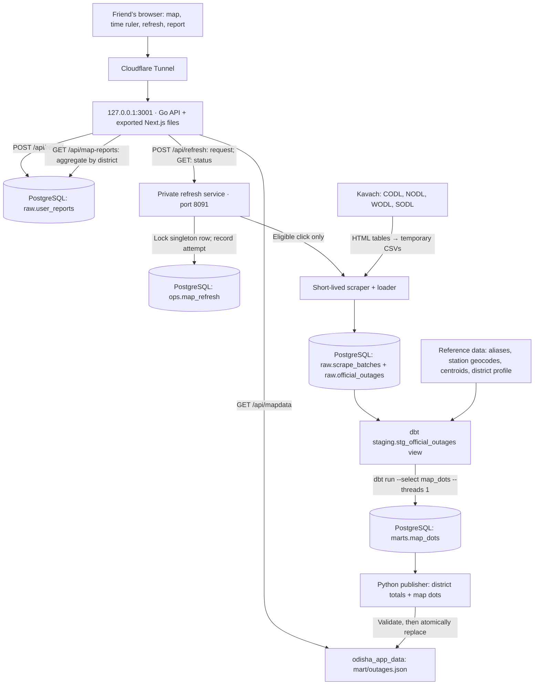
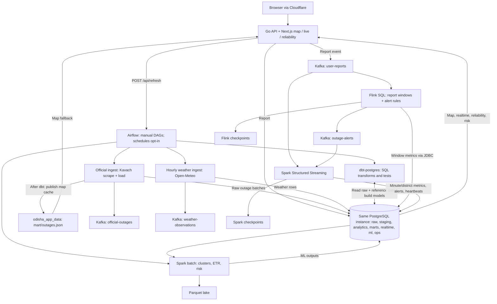

# How the Odisha dashboard runs

PostgreSQL is the single transactional database on the laptop. It owns reports,
official feed batches, reference data, the dbt relations and the refresh limit.
The JSON file is a replaceable map read cache. Submitting a report neither changes
the utility feed nor starts a scrape. dbt runs SQL in PostgreSQL; it is a command,
not an always-running server.

## Laptop mode (default)

The Go app and the private helper are separate containers. The helper reuses the
installed Airflow **image** for its Python and dbt dependencies; its entrypoint
runs only the request handler. It has no scheduler. An eligible click starts a
child process. dbt uses the staging view already installed in PostgreSQL to
resolve districts, parse timestamps, classify causes and assign coordinates.

The helper locks the refresh row before accepting a job. The next eligible time
is three hours after the later of the last attempt and the published snapshot's
timestamp. Friends clicking together share the job. An interrupted or failed
attempt retains the old map and consumes the cooldown. Page loads and status
reads never start a job. The browser polls only while checking a requested job.

The report form uses the Odisha boundary file for GPS lookup. Device
coordinates stay in the browser. The report API resolves a chosen or typed
locality within the selected district and stores its standard name when known.
Unmatched area text remains in PostgreSQL as submitted.

The public map reads the last 24 hours of community reports directly from
PostgreSQL in either mode. It groups known localities and subdistricts at their
reference points and falls back to the district center for unmatched reports.
Only reference labels, approximate coordinates, counts, and the latest report
time are returned. A confirmed save reloads the layer and visible maps check
once per minute. Purple dots mark unverified community reports. Corrections
are excluded. Older station-targeted submissions are treated as corrections.

The API also applies sourced Bhubaneswar locality references to selected
official station names when the feed falls back to the district center. The
tooltip identifies the location as approximate. These points do not certify
the location of equipment or show the footprint of an outage.

Regenerate the area reference with `node scripts/build-report-areas.mjs` after
updating boundaries or mappings. Bhubaneswar reference points and links to
their sources are in `data/mappings/bhubaneswar_areas.json`.

## Full mode (optional)

Airflow also stores its metadata in a separate database on the same PostgreSQL
instance. The Flink submit sidecar watches the SQL job. The platform health DAG
records heartbeats. Kafka initialization creates topics including
`flink-report-windows`; the Flink SQL window sink shown above writes to PostgreSQL.
A report stored while Kafka is off stays in PostgreSQL. Enabling Kafka later does
not replay that report into the live pipeline.

## What stays on

Run the mode commands from `~/odisha-platform`. They target the Odisha Compose
project. Cloudflare Tunnel is the existing public ingress outside this project;
Immich is a separate deployment.

| Component | Laptop default | Switch or dependency |
|---|---|---|
| Go + built frontend | On | The map, controls and public API need it. |
| PostgreSQL 16 | On | Reports and refresh coordination need it. Map reads use the saved cache. Existing volume is reused. |
| Private refresh helper | On, waiting for requests | Only needed for frontend/CLI refresh. Temporary scraper and dbt processes exit after each accepted request. |
| Airflow | Off | `bash scripts/power-mode.sh full` starts the analytics stack. |
| Kafka | Off | `kafka-on` starts just the broker + topic init alongside laptop mode. `kafka-off` stops them. The app still uses PostgreSQL-only reports in this mode. |
| Flink + submit watchdog | Off | Runs in full mode, requires Kafka and PostgreSQL. |
| Spark streaming | Off | Runs in full mode, requires Kafka and PostgreSQL. |
| Weather, batch ML, full dbt rebuild/test/docs, health DAG | Off | Full mode allows manual DAG runs. Also set `ODISHA_SCHEDULES=on` in `platform/.env` and reapply full mode to schedule them. |
| GitHub Pages snapshot build | Separate, manual by default | GitHub Actions workflow dispatch, or its own repository variable `ODISHA_SCHEDULES=on`. It does not refresh the laptop. |

`bash scripts/power-mode.sh snapshot` returns to laptop mode and stops the
optional consumers and broker. No mode switch deletes volumes. Full mode stops
the laptop refresh helper and routes manual refresh through Airflow; the
laptop button's three-hour policy applies to the laptop refresh path.

## Older code and ownership

- **One feed parser:** `outage_rows.py` owns both Kavach CSV layouts and the
  stable content hash. The PostgreSQL loader and Pages exporter import it.
  A copied fallback parser and dynamic import of the entire SQLite pipeline
  were removed.
- **One report form:** the map and live page reuse `QuickReport.js`. Reporting
  availability is independent of the analytics flag.
- **Retired laptop transform:** the old in-memory SQLite refresh implementation
  remains in Git at [1e833c0](https://github.com/SuryaNJena/odisha-power-outage-dashboard/blob/1e833c0/scripts/refresh_snapshot.py).
  Production refresh uses the PostgreSQL loader, dbt model and mart serializer.
- **Keep the Pages exporter:** `process.py` still has a real caller in
  `.github/workflows/scrape-and-deploy.yml`. Its local SQLite file belongs to
  that offline/CI export, never to production report storage. If Pages is retired,
  archive its workflow and exporter together after checking external consumers.
- **Keep optional analytics in place:** full Compose, DAGs, Flink SQL, Spark
  jobs, seeds and models remain executable. Stopping them saves idle resources;
  moving their source to an archive would break the documented switches.

See the [runbook](README.md) for commands, the [contract](CONTRACT.md) for schema
and port definitions, and [map_dots.sql](dbt/models/marts/map_dots.sql) for the
exact latest-batch selection.
